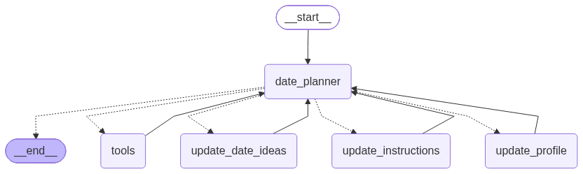

# Date Planner Backend

A LangGraph agent that helps you plan dates in Singapore. It remembers who you are and what you like, keeps a running list of date ideas, and checks live data (weather, haze, UV, real venues, the web) so its suggestions are about real places and real conditions, not made-up ones.

The graph runs on the LangGraph platform (`langgraph dev` locally, or LangGraph Cloud). User profiles and date ideas live in Supabase Postgres, so the frontend can read them directly.

## How it works



Every turn starts at the `date_planner` node. It loads the user's profile and date ideas from Supabase and their saved instructions from the LangGraph store, then calls the model with two kinds of tools:

- **`UpdateMemory`** sends the turn to one of three memory nodes, which update memory and then return to `date_planner`:
  - `update_profile`: uses Trustcall to extract or patch the `Profile` (name, address, partner, budget, interests, dietary restrictions) and upserts it to `user_profiles`.
  - `update_date_ideas`: uses Trustcall with inserts enabled to add new `DateIdea`s or patch existing ones (location, cost, time, notes, status `idea → planned → booked → completed → archived`), then upserts them to `date_ideas`.
  - `update_instructions`: rewrites the user's preferences for how the idea list should be kept and saves them in the LangGraph store.
- **Action tools** go to a `ToolNode`, which also returns to `date_planner`:

  | Tool | Source | Key |
  | --- | --- | --- |
  | `check_weather` | NEA 2-hour / 24-hour / 4-day forecast, picked by `hours_ahead` | none |
  | `check_psi` | NEA 24-hour PSI by region | none |
  | `check_uv_index` | NEA current and peak UV index | none |
  | `find_places` | Google Places API (New) text search | `GOOGLE_MAPS_API_KEY` |
  | `web_search` | Tavily | `TAVILY_API_KEY` |

When the model replies without calling a tool, the turn ends.

### Where data is stored

There are two separate databases. Don't mix them up:

| What | Where | Env var |
| --- | --- | --- |
| Conversation threads and checkpoints, plus the instructions store | LangGraph's own Postgres (in-memory under `langgraph dev`) | `POSTGRES_URI`, `REDIS_URI` |
| `user_profiles`, `date_ideas` | Supabase Postgres | `SUPABASE_DB_URI` |

Profiles and ideas are stored per `(user_id, date_category)`. Both values come from the run's `configurable` (see `graph/configuration.py`).

## Project layout

```
graph/
  date_planner.py      # graph definition: schemas, prompts, nodes, routing
  tools.py             # NEA weather/PSI/UV, Google Places, Tavily
  db.py                # Supabase Postgres access (psycopg pool)
  configuration.py     # configurable fields: user_id, date_category, date_planner_role
  visualize.py         # renders date_planner_graph.png
evals/                 # LangSmith eval suite (in progress; see evalplan.txt)
tests/                 # pytest unit tests for routing and tools
langgraph.json         # LangGraph deployment config
docker-compose.yml     # prod-like local stack (Redis + Postgres + API)
evalplan.txt           # LangSmith evaluation plan
```

## Getting started

### Prerequisites

- Python 3.11
- [LangGraph CLI](https://langchain-ai.github.io/langgraph/cloud/reference/cli/): `pip install "langgraph-cli[inmem]"`
- [Supabase CLI](https://supabase.com/docs/guides/cli) and Docker, for the local app database
- API keys: OpenAI (required), Tavily (required, because `tools.py` builds the client on import), Google Maps (optional; `find_places` reports that it isn't configured if the key is missing), and LangSmith (optional, for tracing)

### 1. Install dependencies

```bash
python -m venv .venv
# Windows
.venv\Scripts\activate
# macOS/Linux
source .venv/bin/activate

pip install -r requirements-dev.txt
```

### 2. Configure the environment

```bash
cp .env.example .env
```

Fill in the keys. `.env.example` explains each variable.

### 3. Start the app database

The Supabase project, including the migrations that create `user_profiles` and `date_ideas`, is kept next to this repo in `../supabase`, not inside it. From the parent folder:

```bash
supabase start
supabase status   # confirm the DB URL matches SUPABASE_DB_URI
```

To use hosted Supabase instead, set `SUPABASE_DB_URI` to the connection string under Project Settings → Database.

### 4. Run the agent

```bash
langgraph dev
```

This starts the API with in-memory checkpoints and store, and opens LangGraph Studio. The graph is registered as `date_planner`.

When you start a run, pass the user in `configurable`:

```json
{ "configurable": { "user_id": "<uuid>", "date_category": "general" } }
```

If you leave them out, `user_id` defaults to `11111111-1111-1111-1111-111111111111` and `date_category` defaults to `general`.

## Prod-like local stack

To test against real Redis and Postgres for checkpoints instead of in-memory state:

```bash
langgraph build -t date-planner-backend
docker compose up
```

The API is then served at `http://localhost:8123`. On LangGraph Cloud, the platform injects `REDIS_URI` and `POSTGRES_URI` for you.

## Testing

```bash
pytest
```

The unit tests cover `route_message` and every action tool. HTTP calls are mocked with `respx`, and `conftest.py` sets dummy API keys, so no network access or real credentials are needed.

## Evaluation

`evalplan.txt` lays out a LangSmith evaluation plan for the five places where the LLM makes a decision: route selection, tool selection, profile extraction, date idea extraction, and response-policy compliance. `evals/target.py` holds the target for the routing and tool-selection suite. It runs the real model with the production system prompt and an empty profile, so it needs a real `OPENAI_API_KEY` but no database. The datasets and evaluators are still to be written.

## Regenerating the graph diagram

```bash
python graph/visualize.py
```

This writes `graph/date_planner_graph.png`.
